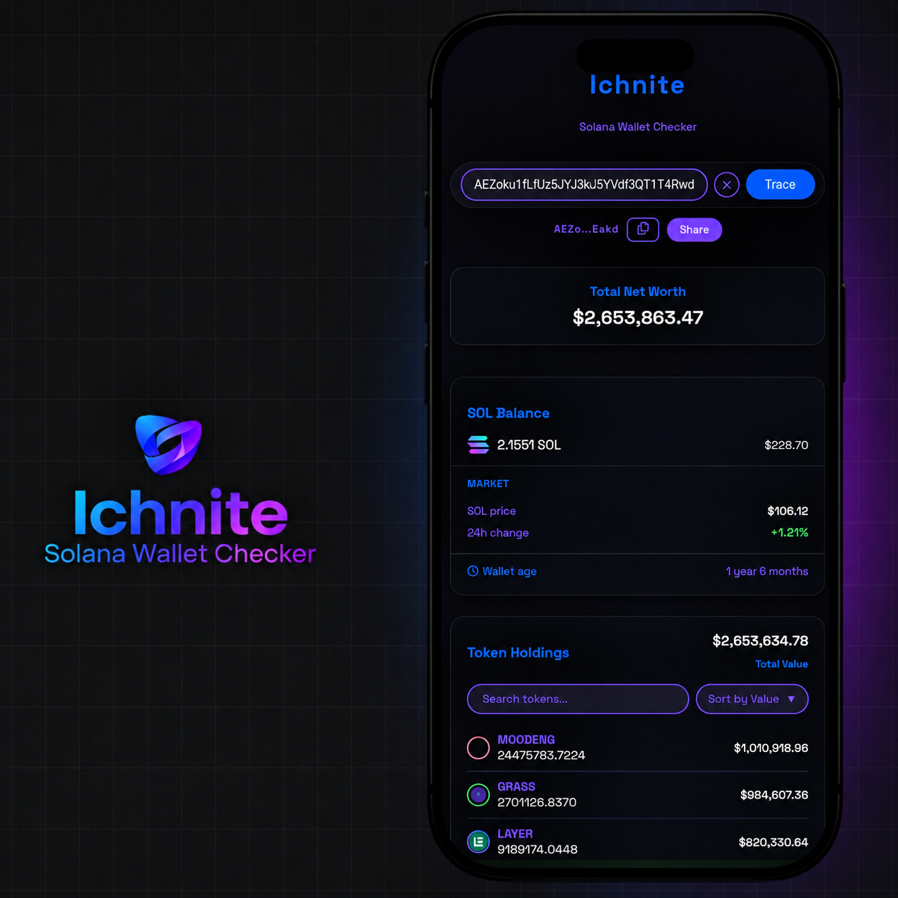
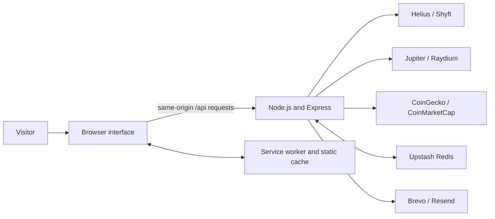
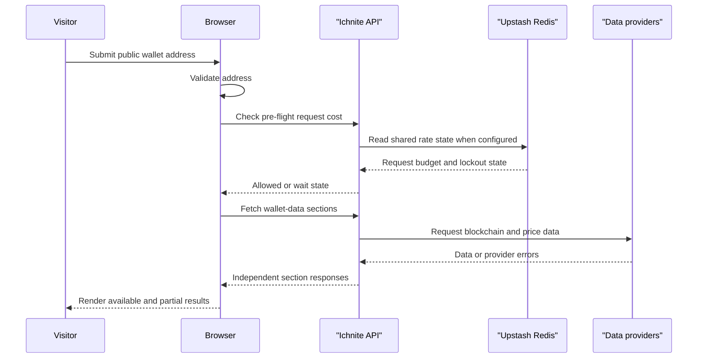

> [!WARNING]
> **Development Branch Notice**
>
> This is the `dev-main` branch. It is a development branch and may be unstable.
>
> - To review the project code, go to the stable [`main`](../../tree/main) branch.
> - Some changes here may not be in `main` because they are still on Devnet.

---

# Ichnite

**Inspect public Solana wallets without connecting a wallet.**

Ichnite is a read-only Solana wallet explorer and installable progressive web app (PWA). Enter a public wallet address to inspect SOL balance and market information, token holdings, NFTs, wallet activity, recent transactions, wallet age, and estimated net worth in one interface. Each major data section reports its own loading, failure, or partial-data state so one provider problem does not have to hide every other result.

**[Open the live app](https://ichnite.vercel.app/)** • [Ichnite · Solana Wallet Checker](https://ichnite.vercel.app/)

## Try it in 60 seconds

**Open [the live app](https://ichnite.vercel.app/), paste a public Solana wallet address, and select Trace.** No account, wallet connection, private key, or seed phrase is required.

## Product preview



The image is a product illustration. Figures shown in the artwork are illustrative, not a live wallet response or current price quote.

## At a glance

| | Details |
|---|---|
| **Category** | Read-only Solana wallet explorer and PWA |
| **Status** | Live production web app at [ichnite.vercel.app](https://ichnite.vercel.app/) |
| **Who it serves** | People inspecting a public Solana wallet address |
| **How it works** | The browser calls Ichnite's API; the server retrieves data from configured blockchain and market providers. |
| **Core components** | Node.js 24.x, Express, vanilla JavaScript, HTML/CSS, Chart.js, and a service worker |
| **Integrations** | Helius, Shyft, Jupiter, Raydium, CoinGecko, CoinMarketCap, Upstash Redis, Brevo, and Resend |
| **Quality** | Repeatable tests are provided through Node.js's built-in test runner. No CI workflow is present in this repository. |
| **Try it** | [Open Ichnite](https://ichnite.vercel.app/) |

## What you can do

| Area | What it does |
|---|---|
| Wallet search | Validates a public Solana address and starts a trace. Recent search history is kept in the browser. |
| Wallet overview | Shows SOL balance, SOL market data when available, wallet age, and estimated total net worth. |
| Token holdings | Lists token balances and estimated values, with search, value sorting, and a distribution chart. |
| NFTs | Displays NFT holdings returned by the configured provider. Live NFT pricing is not included. |
| Wallet activity | Shows Days, Month, and Year chart views. Historical retrieval is bounded and can report partial results. |
| Recent transactions | Displays recent transactions and links to Solscan. |
| Feedback | Accepts anonymous feedback and sends accepted messages through the configured email-provider path. |
| PWA and offline shell | Supports installation where the browser allows it and shows an offline navigation page. Live wallet lookups still require a network connection. |

## How it works

1. **Enter a public address.** The browser checks the address format before starting a trace.
2. **Check the request budget.** The API decides whether the request can proceed and remains authoritative for lockout state.
3. **Fetch independent sections.** The frontend schedules requests with bounded concurrency. The backend queries configured providers and uses supported fallback paths.
4. **Render available results.** Wallet cards keep their own loading, failure, and partial-data states.
5. **Keep live data online.** The service worker caches static application files, not live wallet or market responses.



## Runtime and request limits

These values are defined in [public/app.js](public/app.js), [server.js](server.js), and [.env.example](.env.example).

| Control | Current setting |
|---|---|
| Node.js line | `24.x` in `package.json`; the latest applicable Node.js 24.x security patch verified on 2026-10-23 is `v24.22.1` ([official release](https://nodejs.org/en/blog/release/v24.22.1)). |
| Trace request scheduling | Up to 3 active trace jobs |
| Trace request accounting | Base cost 7; pre-flight reservation 8 |
| Shared API budget | 100 counted requests per rate-limit identity in 15 minutes |
| Abuse lockout | Separate 15-minute lockout; not the same as the request-window counter |
| Wallet activity history | Up to 250 pages within a 60,000 ms operation budget |
| Chart pagination | 150 ms page delay, up to 3 retries, 1,000 ms retry base delay |
| Chart result cache | 90,000 ms TTL and up to 200 entries |
| NFT pagination | Up to 50 pages with 1,000 assets per page; separate from chart pagination |
| Upstream request bounds | 10-second timeout, maximum 5 redirects, and maximum 10 MiB JSON response body per provider request |
| Feedback submission timing | 2,500 ms minimum timing check |

Vercel selects Node.js by major line and may roll out patch releases automatically. The `24.x` engine declaration does not prove which exact patch a particular deployment is running. See [Vercel's supported Node.js versions](https://vercel.com/docs/functions/runtimes/node-js/node-js-versions) and check current deployment settings/logs when verifying production runtime evidence.

## API endpoints

Routes are implemented in [server.js](server.js). They are used by the frontend and are not a public provider-agnostic API contract.

| Method and route | Purpose |
|---|---|
| `GET /api/ping` | Lightweight server reachability check; exempt from the counted API budget and lockout middleware |
| `GET /api/rate-limit-status?cost=...` | Reads the request budget and lockout state and supports pre-flight checks |
| `GET /api/sol-price` | Retrieves SOL price and 24-hour change |
| `GET /api/sol-balance?address=...` | Retrieves a wallet's SOL balance |
| `POST /api/token-prices-live` | Retrieves current prices for token mints |
| `GET /api/token-metadata?mints=...` | Resolves metadata for comma-separated mint addresses |
| `GET /api/tokens?address=...` | Retrieves token holdings |
| `GET /api/nfts?address=...` | Retrieves NFT holdings |
| `GET /api/transactions/chart?address=...&years=...` | Retrieves bounded wallet activity history |
| `GET /api/transactions/recent?address=...` | Retrieves recent transactions |
| `GET /api/wallet-age?address=...` | Looks up the earliest available transaction timestamp |
| `GET /api/nft-image-fallback` | Returns an NFT image fallback |
| `GET /api/token-logo-fallback` | Returns a token logo fallback |
| `POST /api/feedback` | Validates feedback and attempts email delivery |

## Run locally

### Prerequisites

- Node.js 24.x and npm.
- Provider credentials for the data you want to retrieve. Without the relevant credentials, some data sections may be unavailable or have reduced fallback coverage.
- Upstash Redis and email-provider credentials for the shared production request store and feedback delivery path.

For local patch alignment, Node.js `v24.22.1` was the latest applicable security patch published by the Node.js project on 2026-10-21. Install it using the method appropriate for your platform and confirm with `node --version`.

### Install and configure

From the repository root:

```bash
npm ci
cp .env.example .env
```

Edit the local `.env` file and add values for the services you intend to use. Never commit the file. [.gitignore](.gitignore) excludes local environment files while allowing `.env.example` to remain in version control.

### Environment variables

| Variable | Purpose |
|---|---|
| `PORT` | Local server port; defaults to 3000 |
| `NODE_ENV` | Set to `development` for local diagnostics; production should use `production` |
| `HELIUS_API_KEY` | Primary Solana data provider |
| `HELIUS_BARCHART_TRANSACTION_API_KEY` | Dedicated wallet-activity chart capacity |
| `SHYFT_API_KEY` | Partial fallback for supported wallet/token/NFT data |
| `JUPITER_API_KEY` | Token price provider configuration |
| `COINGECKO_API_KEY`, `CMC_API_KEY` | SOL market-data provider configuration and fallback |
| `TRUST_PROXY` | Express proxy trust configuration; set to match the actual deployment topology |
| `ALLOWED_ORIGINS` | Comma-separated browser origins accepted in deployment |
| `DEBUG_TRUST_PROXY` | Development-only diagnostic switch; diagnostics are ignored outside development |
| `UPSTASH_REDIS_REST_URL`, `UPSTASH_REDIS_REST_TOKEN` | Shared request-limit state and Redis-backed support state |
| `REDIS_KEY_PREFIX`, `FEEDBACK_REDIS_KEY_PREFIX` | Separate Redis key namespaces |
| `HELIUS_CHART_PAGE_DELAY_MS`, `HELIUS_RETRY_BASE_DELAY_MS`, `HELIUS_MAX_PAGE_RETRIES`, `HELIUS_MAX_TX_PAGES`, `HELIUS_TX_TIME_BUDGET_MS`, `HELIUS_CHART_CACHE_TTL_MS`, `HELIUS_CHART_CACHE_MAX_ENTRIES` | Wallet activity pagination and chart cache controls |
| `HELIUS_MAX_NFT_PAGES`, `HELIUS_NFT_PAGE_DELAY_MS`, `HELIUS_NFT_MAX_PAGE_RETRIES`, `HELIUS_NFT_RETRY_BASE_DELAY_MS` | Independent NFT ownership pagination controls |
| `BREVO_API_KEY`, `RESEND_API_KEY` | Primary and fallback feedback email provider credentials |
| `FEEDBACK_RECIPIENT_EMAIL`, `BREVO_SENDER_EMAIL`, `RESEND_SENDER_EMAIL`, `FEEDBACK_SENDER_NAME` | Feedback email routing and sender identity |
| `CODESPACE_NAME` | Development-only Codespaces CORS support |

The complete list and default values are in [.env.example](.env.example). All credentials belong in local or deployment environment settings, never in source files or browser code.

### Start the server

```bash
npm run dev
```

Open [http://localhost:3000](http://localhost:3000). For a server without automatic restart, use `npm start`.

## Tests and validation

Run the repeatable tests with:

```bash
npm test
```

The test suite uses Node.js's built-in test runner in [test/security.test.js](test/security.test.js). It covers outbound-fetch timeout/response-size/redirect caps, HTTPS enforcement, provider error redaction, HTTP status and invalid JSON handling, production CORS and proxy-log privacy, malformed and oversized JSON bodies, rejection of compressed JSON bodies, feedback validation, the request budget, and health/status exemptions. A separate UI regression check protects the mobile clear-button and keyboard-focus styles and confirms cached stylesheet changes advance the service-worker cache version. These tests are not a substitute for provider-backed checks against configured Helius, pricing, Redis, or email accounts.

This repository has no configured CI workflow. Test results must come from an actual local `npm test` run; the existence of the command alone is not evidence that a run passed.

## Security and privacy

- **Read-only access.** Ichnite queries public-chain information. It does not connect to wallets, sign transactions, or request private keys or seed phrases.
- **Server-side credentials.** Provider and email credentials are read by [server.js](server.js); the browser calls Ichnite's `/api/*` routes rather than providers directly.
- **Bounded outbound requests.** Data and feedback provider requests use a shared timeout, response-size limit and redirect cap. Transport and JSON errors are sanitized so raw request URLs, provider payloads, or API keys embedded in provider URLs are not copied into the usual error logs.
- **Compressed JSON bodies.** API JSON parsing rejects compressed request bodies before decompression while preserving the 100 KiB request limit. Ichnite's browser sends uncompressed JSON; this mitigation addresses [the body-parser compressed-body denial-of-service advisory](https://github.com/expressjs/body-parser/security/advisories/GHSA-27r3-jxmh-p828) without removing an existing user flow.
- **HTTPS-only provider transport.** The common outbound-fetch helper rejects non-HTTPS URLs. Provider destinations remain defined by backend code, not by a user-submitted URL.
- **Production logging.** Detailed CORS-origin and proxy/IP diagnostics are limited to development. Production error logs use safe categories, and wallet addresses are omitted from chart truncation logs.
- **Request limiting.** The server has a 100-request/15-minute budget and a separate 15-minute lockout. Configure both `UPSTASH_REDIS_REST_URL` and `UPSTASH_REDIS_REST_TOKEN` for shared request-rate state across serverless instances.
- **Local history.** Recent addresses are stored in browser `localStorage`; clear them in the app or clear this site's browser storage to remove them.
- **Feedback.** Feedback is anonymous in the interface, but its message is sent to the configured product inbox. Do not include information you do not want to send.
- **PWA behavior.** Static files can be cached for app startup and offline navigation. Live wallet, price, transaction, and feedback requests still require a network connection.

## Architecture



- **State location.** There is no persistent wallet database. Search history and countdown state are browser-local, chart/cache data is in server memory, and Upstash stores shared request and feedback support state when configured.
- **Provider fallbacks.** Helius is primary for Solana data; Shyft covers only supported fallback areas. Jupiter/Raydium handle token pricing, CoinGecko/CoinMarketCap handle SOL pricing, and Brevo/Resend handle feedback delivery.
- **Cache boundaries.** Token, logo and NFT metadata cache entries are in memory. Persistent Redis caching for that metadata and live NFT pricing are not included.
- **Independent cards.** A failure in one upstream data section does not intentionally block unrelated wallet sections.

## Repository structure

```text
.
├── .env.example
├── .gitignore
├── README.md
├── package.json
├── package-lock.json
├── server.js
├── lib/
│   └── upstream-fetch.js
├── test/
│   └── security.test.js
└── public/
    ├── app.js
    ├── css/
    │   └── style.css
    ├── images/
    │   ├── ichnite-product-preview.png
    │   ├── logo.png
    │   ├── logo.svg
    │   └── sol-logo.png
    ├── index.html
    ├── manifest.json
    ├── offline.html
    └── sw.js
```

## Production and release notes

Ichnite is live at [ichnite.vercel.app](https://ichnite.vercel.app/). This batch changes only the `dev-main` branch; it does not merge into `main` or deploy the production app.

Before releasing these changes, merge through the project's normal review process and redeploy through Vercel. Then verify the deployment's Node.js runtime/version from current Vercel settings or build/runtime logs, open the app, trace a valid public wallet, verify invalid-address messaging and partial cards, confirm rate-limit status/lockout behavior, submit feedback only in a controlled test, and test PWA update/offline navigation in a browser with an existing service-worker cache.

## Known limitations and missing repository evidence

- Wallet-data and market-data results depend on external providers and their configured credentials, quotas, and availability.
- Activity history is bounded by its page and time limits; older history may be partial.
- NFT holdings are shown without live NFT pricing.
- Offline support covers static application behavior, not live wallet data.
- There is no CI workflow in the repository.
- `package.json` declares `MIT`, but there is no root `LICENSE` file in the current repository tree.
- The exact Node.js patch used by the live Vercel deployment cannot be established from the repository source alone; verify it in deployment evidence.
