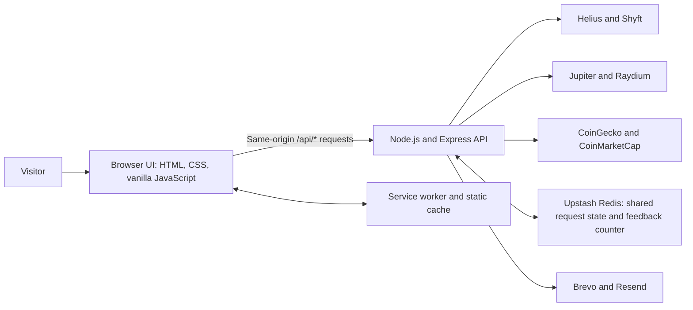
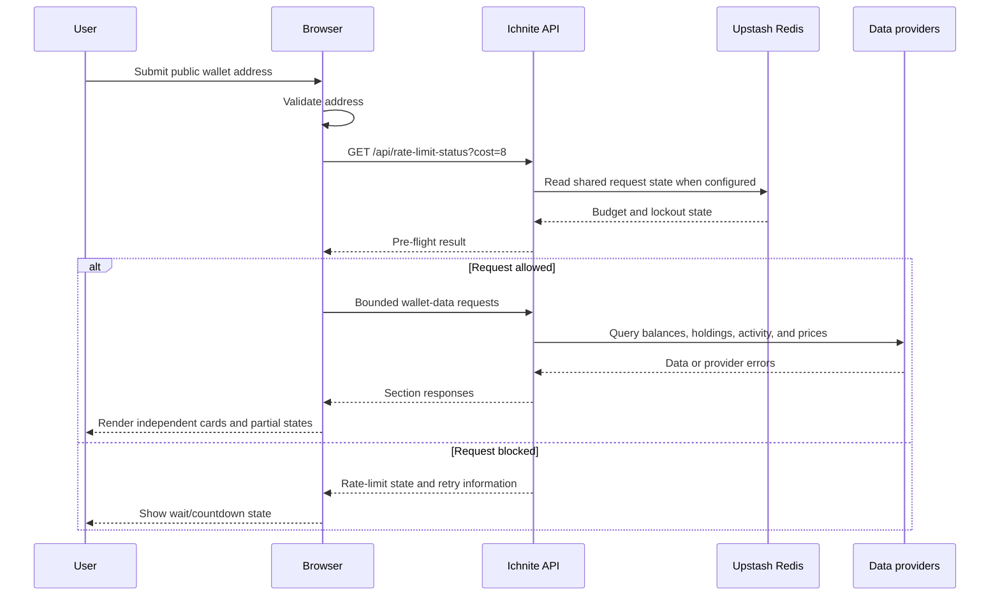

# Ichnite

**Inspect public Solana wallets without connecting a wallet.**

Ichnite is a read-only Solana wallet explorer and installable progressive web app (PWA). Paste a public wallet address to view SOL balance and market data, token holdings, NFTs, wallet age, activity, recent transactions, and estimated net worth in one interface. Each major data section can report its own failure or partial result, so one provider problem does not have to hide every other result.

**[Open the live app](https://ichnite.vercel.app/)** • [Ichnite · Solana Wallet Checker](https://ichnite.vercel.app/)

## Try it in 60 seconds

**Open [Ichnite](https://ichnite.vercel.app/), paste a public Solana wallet address, and select `Trace`.** You do not need to install anything, create an account, connect a wallet, or provide a private key or seed phrase.

## Product preview


*This supplied artwork is a visual preview. The wallet figures shown in it are not evidence of a live wallet query or current market prices.*

## At a glance

| | Details |
|---|---|
| **Category** | Public Solana wallet explorer and PWA |
| **Status** | Live production app: [ichnite.vercel.app](https://ichnite.vercel.app/) |
| **Who it serves** | People who want to inspect a public Solana address without connecting a wallet |
| **How it works** | A browser interface calls the Ichnite API; the server retrieves wallet and market information from external providers. |
| **Core components** | Node.js, Express, vanilla JavaScript, HTML/CSS, Chart.js, and a service worker. See [package.json](package.json), [public/app.js](public/app.js), and [public/sw.js](public/sw.js). |
| **Integrations** | Helius, Shyft, Jupiter, Raydium, CoinGecko, CoinMarketCap, Upstash Redis, Brevo, and Resend. See [server.js](server.js). |
| **For newcomers** | No wallet connection or signing is required. The address must be public. |
| **Quality evidence** | The supplied `npm test` script is a placeholder; no automated test suite or CI configuration was supplied. |
| **Try it** | [Open the live app](https://ichnite.vercel.app/) |

## What you can do

| Area | What it does |
|---|---|
| Wallet search | Validates a public Solana address and starts a trace. The app keeps a small recent-search list in your browser. |
| Wallet overview | Shows SOL balance, SOL price and 24-hour change when available, wallet age, and estimated total net worth. |
| Token holdings | Lists token balances and estimated values, with token search, value sorting, and a distribution chart. |
| NFTs | Displays NFTs owned by the address when the provider returns the data. Live NFT pricing is not included. |
| Wallet activity | Shows activity charts with Days, Month, and Year views. Historical retrieval is deliberately bounded, and partial results may be returned. |
| Recent transactions | Lists recent transactions and provides a link to view the wallet on Solscan. |
| Feedback | Accepts anonymous feedback without name or email fields and sends it through the configured email-provider path. |
| PWA and offline shell | Supports installation where the browser allows it and an offline navigation page. Live wallet lookups still require internet access. |

### API endpoints

The browser uses the same-origin `/api/*` routes. These endpoints are implemented in [server.js](server.js).

| Method and route | Purpose |
|---|---|
| `GET /api/ping` | Lightweight server reachability check. |
| `GET /api/rate-limit-status?cost=...` | Reads the caller's rate-limit and lockout state and supports pre-flight checks. |
| `GET /api/sol-price` | Retrieves SOL price and 24-hour change. |
| `GET /api/sol-balance?address=...` | Retrieves the wallet's SOL balance. |
| `POST /api/token-prices-live` | Retrieves current prices for supplied token mints. |
| `GET /api/token-metadata?mints=...` | Resolves token metadata for comma-separated mint addresses. |
| `GET /api/tokens?address=...` | Retrieves token holdings. |
| `GET /api/nfts?address=...` | Retrieves NFT holdings. |
| `GET /api/transactions/chart?address=...&years=...` | Retrieves bounded wallet activity history. |
| `GET /api/transactions/recent?address=...` | Retrieves recent transactions. |
| `GET /api/wallet-age?address=...` | Looks up the earliest available transaction timestamp. |
| `GET /api/nft-image-fallback` | Returns the NFT image fallback asset. |
| `GET /api/token-logo-fallback` | Returns the token logo fallback asset. |
| `POST /api/feedback` | Validates feedback and attempts email delivery. |

## How it works

1. **Enter a public address.** The browser validates the address before starting the lookup.
2. **Check the request budget.** The frontend asks the backend for the current rate-limit state before it starts a trace.
3. **Fetch independent sections.** The frontend schedules requests with bounded concurrency. The backend calls providers and applies supported fallback paths.
4. **Render what is available.** Balance, tokens, NFTs, activity, recent transactions, wallet age, and total value have independent loading and failure states.
5. **Keep live data online.** The service worker can cache the app shell and provide an offline navigation page, but API requests are not treated as offline data.

### Runtime limits

The values below are defined in [public/app.js](public/app.js), [server.js](server.js), and [.env.example](.env.example). Environment values can override the documented defaults where the server supports them.

```text
Trace scheduling: maximum 3 active jobs; trace base request cost 7; pre-flight reservation 8.
API request budget: 100 counted API requests per IP per 15-minute window; /api/ping and /api/rate-limit-status are exempt; a separate custom lockout lasts 15 minutes.
Wallet activity: maximum 250 pages; 60,000 ms operation budget; 150 ms page delay; up to 3 retries; 1,000 ms retry base; 90,000 ms cache TTL; 200 cached entries maximum.
NFT ownership: maximum 50 pages; 1,000 assets per page; 150 ms page delay; up to 3 retries; 1,000 ms retry base.
Recent search history: maximum 3 addresses in browser localStorage.
Feedback timing check: 2,500 ms minimum elapsed time from the page-load/focus timestamps.
```

## Words you'll see

- **Public wallet address:** An address that can be queried on the Solana blockchain. It is not a private key.
- **SOL:** Solana's native asset.
- **Token mint:** The on-chain identifier for a token. Ichnite uses mint addresses, not token symbols, to identify token data.
- **NFT:** A non-fungible token. The NFT section shows ownership data returned by the configured provider; it does not provide live NFT prices.
- **PWA:** A website that a compatible browser can install and launch in an app-like window.
- **Provider:** An external service that supplies blockchain, token, price, or email functionality to Ichnite.

## Architecture



The backend is the boundary between the browser and provider credentials. The main lookup flow is:



- **Trust boundary.** The browser calls Ichnite routes, not the blockchain and market providers directly. Provider keys are read by the backend from environment variables.
- **State.** There is no wallet-record database in the supplied application. Search history is in browser `localStorage`; the chart cache is in server memory. Upstash Redis supports the distributed request counter, lockout persistence, and feedback sequence when configured.
- **Fallbacks.** Helius is the primary structural/transaction provider, with Shyft fallback only for supported data. Jupiter is primary for token prices with Raydium fallback; CoinGecko is primary for SOL price with CoinMarketCap fallback. Feedback delivery tries Brevo and then Resend for qualifying failures.
- **External dependencies.** Availability, provider quotas, upstream response formats, browser support, and email sender verification can affect features. A section can be unavailable even when the frontend loads.

## Built with

| Technology | Role in this project |
|---|---|
| Node.js 24.x | Runtime target declared by [`package.json`](package.json). |
| Express | Serves the API and static application files in [`server.js`](server.js). |
| Vanilla JavaScript, HTML, and CSS | Handles wallet input, bounded request scheduling, UI state, charts, and responsive layout in [`public/app.js`](public/app.js), [`public/index.html`](public/index.html), and [`public/css/style.css`](public/css/style.css). |
| Chart.js | Renders token distribution and wallet activity charts; loaded by the browser from a CDN in [`public/index.html`](public/index.html). |
| Helmet and CORS | Configure security headers and allowed browser origins in [`server.js`](server.js). |
| express-rate-limit | Enforces the API request budget; the server uses an Upstash-backed store when Redis configuration is available. |
| Upstash Redis | Stores shared request counters/lockouts and the feedback sequence counter when configured. |
| Helius and Shyft | Supply Solana wallet, token, NFT, and transaction data within their supported roles. |
| Jupiter and Raydium | Supply token price data. |
| CoinGecko and CoinMarketCap | Supply SOL price and 24-hour change, with a fallback path. |
| Brevo and Resend | Deliver accepted feedback messages through the backend. |
| Service worker and web app manifest | Cache the static app shell and define installable PWA behavior in [`public/sw.js`](public/sw.js) and [`public/manifest.json`](public/manifest.json). |

## Production deployment

| App | URL | Environment | Verification |
|---|---|---|---|
| Ichnite | [https://ichnite.vercel.app/](https://ichnite.vercel.app/) | Vercel production | The production web app works |

| Component | Source | Role |
|---|---|---|
| Browser app | [`public/index.html`](public/index.html), [`public/app.js`](public/app.js), [`public/css/style.css`](public/css/style.css) | Search UI, results, cards, chart controls, and feedback widget. |
| API server | [`server.js`](server.js) | Provider access, response shaping, rate limiting, feedback validation, and static serving. |
| PWA shell | [`public/manifest.json`](public/manifest.json), [`public/sw.js`](public/sw.js), [`public/offline.html`](public/offline.html) | Install metadata, static caching, and offline navigation fallback. |
| Runtime configuration template | [`.env.example`](.env.example) | Lists environment-variable names and documented defaults without credential values. |

## Security and privacy

- **Read-only access.** Ichnite requests public chain data and does not ask for wallet connection, transaction signing, private keys, or seed phrases.
- **Server-side credentials.** Provider and email API keys are read by [`server.js`](server.js) from environment variables; they should not be placed in browser code or committed to source control.
- **Wallet addresses still leave the browser.** The address is sent to the Ichnite API so the backend can query external providers. Do not treat a public address as secret, but remember that it can reveal public on-chain activity.
- **Local search history.** The browser stores up to 3 recent addresses in `localStorage`, under the `IchniteHistory` key. Remove entries from the history UI or clear the site's browser storage if needed. This behavior is implemented in [`public/app.js`](public/app.js).
- **Rate limiting.** The server uses the request IP as the rate-limit key. For a deployment spanning multiple serverless instances, configure `UPSTASH_REDIS_REST_URL` and `UPSTASH_REDIS_REST_TOKEN` so the request counter is shared. Without Redis configuration, `express-rate-limit` uses its default in-process store, which is not shared across instances.
- **Feedback.** The form has no name or email fields. Server-side validation includes a hidden honeypot, blocked-content checks, a timing check, and provider fallback. Accepted messages are sent to the configured recipient. Feedback delivery requires Redis and valid email-provider/sender configuration.
- **Cross-origin requests.** Production browser origins are controlled with `ALLOWED_ORIGINS`; local development origins are allowed by the development configuration.

## Repository structure


```text
.
├── .env.example
├── .gitignore
├── package.json
├── README.md
├── server.js
├── docs/
│   └── images/
│       └── ichnite-product-preview.png
└── public/
    ├── app.js
    ├── css/
    │   └── style.css
    ├── images/
    │   └── logo.svg
    ├── index.html
    ├── manifest.json
    ├── offline.html
    └── sw.js
```

## Run locally

### Prerequisites

- Node.js `24.x`, as declared in [`package.json`](package.json).
- npm.
- Provider credentials for the wallet and pricing features you want to use.

### Install and configure

From the repository root:

```bash
npm install
cp .env.example .env
```

Edit `.env` locally. Do not commit it. `.gitignore` excludes `.env` files while allowing `.env.example` to be committed.

For a meaningful wallet trace, configure `HELIUS_API_KEY`. The activity chart uses `HELIUS_BARCHART_TRANSACTION_API_KEY` in production; development code can explicitly fall back to `HELIUS_API_KEY` when the dedicated chart key is absent. `SHYFT_API_KEY`, `JUPITER_API_KEY`, `COINGECKO_API_KEY`, and `CMC_API_KEY` support the provider roles described above.

To use distributed rate-limit state and feedback, configure `UPSTASH_REDIS_REST_URL` and `UPSTASH_REDIS_REST_TOKEN`. Feedback delivery also needs at least one of `BREVO_API_KEY` or `RESEND_API_KEY`, a matching provider-specific sender (`BREVO_SENDER_EMAIL` or `RESEND_SENDER_EMAIL`), and `FEEDBACK_RECIPIENT_EMAIL`. Review all available names and defaults in [`.env.example`](.env.example).

### Start the server

```bash
npm run dev
```

Then open [http://localhost:3000](http://localhost:3000). To run without automatic restarts, use `npm start`. In development, the app allows the local origins on port `3000`; production deployments must configure `ALLOWED_ORIGINS` for their frontend origin.


## Limitations

- **Wallet data depends on providers.** Provider outages, rate limits, and incomplete upstream responses can leave a card unavailable or return partial results.
- **Net worth is an estimate.** It reflects the SOL and token price data available to the app, not a guaranteed valuation or a financial recommendation.
- **Activity history is bounded.** Chart retrieval stops at the configured page or time budget, so older history may be partial.
- **NFT pricing is not included.** The NFT section reports holdings rather than live floor prices or valuations.
- **Offline mode is limited.** The app shell can be cached, but wallet, price, transaction, and feedback requests need a network connection.
- **Provider configuration affects feature availability.** A missing dedicated chart key, Redis configuration, or feedback sender can disable the corresponding feature or its production-safe behavior.
- **Third-party assets are dependencies.** The page loads Space Grotesk, Font Awesome, and Chart.js from external CDNs, with service-worker caching where it succeeds.
